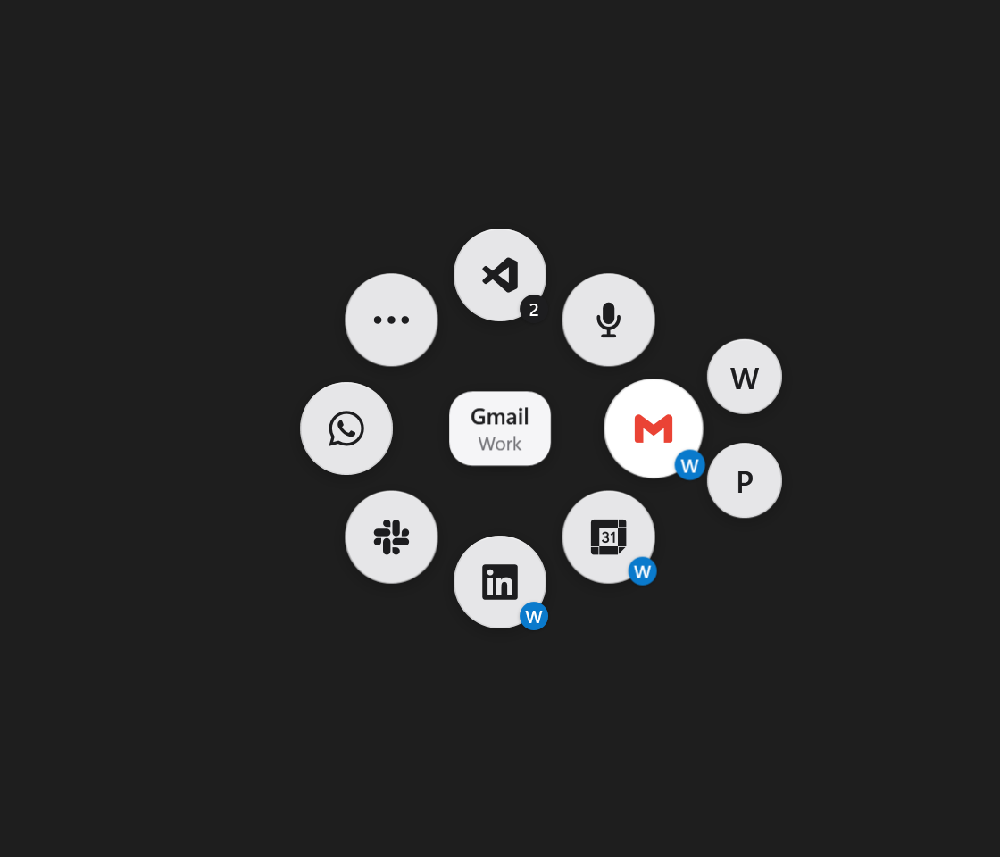

# Thumbring

A custom radial menu for the thumb panel of the Logitech MX Master 4 on Windows. Press the panel and eight quiet buttons appear at your cursor.



Thumbring knows which Chrome profile you are working in. Keep work and personal in two profiles and one Gmail button is enough:

- Working in your Work profile: Gmail opens your Work Gmail.
- Already on Work Gmail: the same button switches to Personal Gmail.
- In another app: it goes to the profile you used last.
- Hover the button to pick a profile by hand.

With the Chrome extension it jumps to the tab you already have open, so you never collect duplicate tabs.

If you use Claude Code, your mouse can also tell you when a chat is finished. One pulse means finished. A knock means the chat needs your permission. Both are silent, so they work during a call.

## What you need
- Windows 10 or 11
- Logitech MX Master 4
- Logi Options+
- Google Chrome, for the Chrome buttons

## Install
1. Download `Thumbring-win-x64.zip` from [Releases](../../releases) and unzip it to a folder you keep.
2. Start `Thumbring.exe`. Windows may warn you because the app is not signed. It appears as a ring in the system tray and installs its vibration plugin into Logi Plugin Service.
3. In Options+, click your MX Master 4, click the thumb panel and assign a keyboard shortcut. Press `Ctrl+Alt+Shift+F12`.
4. In each Chrome profile, open `chrome://extensions`, turn on Developer mode, click Load unpacked and pick the `extension` folder.
5. Right-click the tray icon. Tick **Start with Windows**. Tick **Claude Code alerts** if you use Claude Code.

Press the thumb panel. To close the ring, press it again, press Esc or click outside it.

## Make it yours
Right-click the tray icon and choose **Edit buttons**. That opens `%LOCALAPPDATA%\Thumbring\config.json`, which Thumbring writes on first start with your two most used signed-in Chrome profiles. Choose **Reload buttons** after saving.

A space is one Chrome profile:

```json
{ "id": "work", "name": "Work", "chromeProfile": "Profile 1", "letter": "W", "color": "#0A7ACC" }
```

Set `"startSpace": "work"` at the top level to choose the space used after a restart.

There are five kinds of button:

| Kind | What it does | Fields |
|---|---|---|
| `smart` | Same page in the space you are in, and switches space when you are already there | `url`, `titleMatch`, `preferSpace` |
| `page` | One page in one space | `url`, `space` |
| `app` | Brings an app to the front or starts it | `process`, `launch` |
| `dictate` | Starts dictation | `keys` |
| `folder` | Fans out more buttons on hover | `children` |

Every button also takes `id`, `name`, `color` and one of these for its picture:

- `icon`: a built-in name (`gmail`, `calendar`, `linkedin`, `hubspot`, `slack`, `whatsapp`, `notion`, `vscode`, `mic`, `dots`, `bars`) or raw SVG path data for your own logo. A space takes `icon` too.
- `iconExe`: the path of an app, to use its icon.
- `letter`: one letter.

`titleMatch` is a regular expression on the window title. It tells Thumbring that you are already on that page.

`launch` can be a path, a URI such as `slack:` or `shell:AppsFolder\<app id>`. Environment variables such as `%LOCALAPPDATA%` work.

Dictate fires the hands-free shortcut of [Wispr Flow](https://wisprflow.ai) when it is installed and Windows voice typing otherwise. Set `keys` to a list of virtual key codes to use something else. `Ctrl+Alt+Shift+F11` also starts dictation, for a spare mouse button.

The middle of the ring goes back to your previous window.

Pick your vibrations from the tray menu. Each choice plays the pattern, so you can feel all 15.

## How it works
```
Thumb panel → Ctrl+Alt+Shift+F12 from Options+ → Thumbring.exe shows the overlay
Click       → chrome.exe in the right profile  → the extension jumps to the open tab
Hover       → named pipe → Logi plugin         → mouse vibrates
Claude Code → hook runs Thumbring.exe --hook   → mouse vibrates
```

- `app`: the overlay in C# and WPF. It never takes focus, so the window below it stays active. That is how it knows where you are.
- `plugin`: a thin Logi Actions SDK plugin, because Logi Plugin Service is the way to reach the vibration motor.
- `extension`: a Chrome extension that needs the `tabs` and `webNavigation` permissions.

Chrome window titles do not show the profile. The window's AppUserModelID does, which is how Thumbring tells profiles apart. If your window id differs, set `chromeWindowId` on the space.

## Privacy
Thumbring has no network code, accounts or analytics. Everything stays in `%LOCALAPPDATA%\Thumbring`. It reads the title of the active window, Chrome's list of profiles and Wispr Flow's shortcut setting. It does not read page content or browsing history.

**Claude Code alerts** adds hooks to `~/.claude/settings.json` and saves a backup next to it first. Unticking removes them. The hooks pass the chat's session id and an event name to Thumbring on your own computer.

## Build from source
You need the .NET 8 and .NET 10 SDKs and Logi Options+, which provides `PluginApi.dll`.

```powershell
./build.ps1
```

The zip lands in `dist`. `tests/extension-test.js` runs the extension in a throwaway Chrome profile.

## Status
Thumbring has been used on one Windows 11 laptop with one MX Master 4. Please open an issue if it behaves differently on yours.

## Not affiliated
This is an independent project and is not made or endorsed by Logitech, Google, Anthropic or any other company named here. Product names and logos belong to their owners. Built-in icons come from [Simple Icons](https://simpleicons.org) (CC0).

## License
MIT
